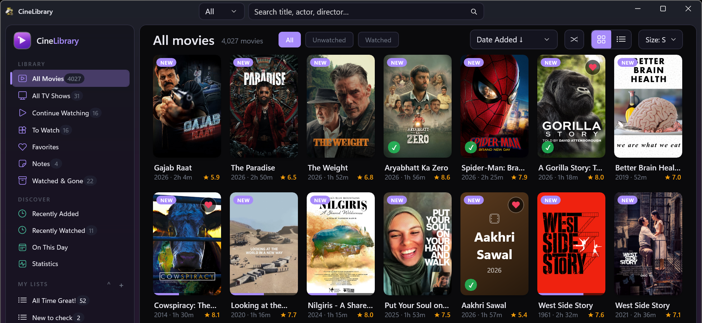
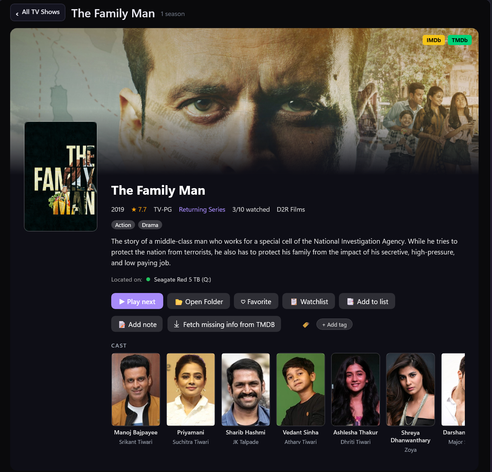

<div align="center">

# 🎬 CineLibrary

**A fast, native Windows app to browse, manage and play your movies & TV shows.**

Browse, search, and play across any number of external drives - offline, portable, no telemetry.

[](https://github.com/aungkokomm/CineLibraryCS/releases/latest)


</div>

> ***Stop letting your movies gather dust in forgotten directories.***
> CineLibrary makes your whole collection visible, searchable, and alive again.

**A constantly evolving passion project** - check the [latest release](https://github.com/aungkokomm/CineLibraryCS/releases/latest) for what's new.

---

## What is CineLibrary?

CineLibrary turns your movie and TV folders into a beautiful library you can browse, manage and play, across as many external drives as you own. The built-in player remembers where you stopped, your audio and your subtitles.

Unplug a drive and its titles stay visible, ready for when it comes back. It's free and open source, runs from any folder, and needs no account.

It reads standard Kodi-style `.nfo` files and artwork. Folders not ready yet? [CineLibrary Essentials](https://github.com/aungkokomm/CineLibraryEssentials) renames, organizes and scrapes them for you.

---

## 📸 Screenshots

Your whole collection at a glance: the sidebar, the search, and every filter and sort on one tidy row.



✨ **Richer, deeper movie details than ever before** - discover the stories behind your collection in a whole new way.


📺 **TV shows get a page of their own**: the fanart, the cast with photos, the drive the show is on, and every episode in a list with Favorite and Watched buttons.



---

## ✨ Highlights

- **▶️ A built-in player** - films and episodes play right inside the app, and it remembers where you stopped, your audio and your subtitles. Prefer your own player? VLC, MPC-HC, PotPlayer or mpv work too.
- **⏯️ Continue Watching** - everything you've started, films and shows together, grouped into This week, This month and Earlier.
- **📺 Movies & TV shows** - full show pages with seasons, episodes, IMDb and TMDb ratings, the aired episodes you're missing, per-episode watched/favorite/notes, and "▶ Play next unwatched."
- **💾 Multi-drive, offline-aware** - index any number of external drives; offline ones stay visible with posters intact, and your watched state, favorites and notes travel with each drive.
- **🏷️ Your own organization** - favorites, watchlist, notes, free-form tags and custom lists, with fast search and filters by genre, decade, rating, collection and watched status.
- **🧭 Discovery** - Recently Watched, Recently Added, On This Day, a filter-aware Surprise Me, and **Watched & Gone**, a memory keeper for films you watched then deleted.
- **🩹 Fill the gaps** - fetch a partly-scraped title's missing info from TMDB, get IMDb ratings for your whole library in one click, and copy fetched art onto your drives. Fill-only: your existing data is never overwritten.
- **🧹 Keep it tidy** - find duplicates with reclaimable-space totals, and back up all your personal state to one portable file.
- **🚀 Native & quick** - cold start under a second; smooth scrolling through thousands of posters.

> Full per-version notes live on the [**Releases**](https://github.com/aungkokomm/CineLibraryCS/releases) page.

---

## ⬇️ Download & install

1. Grab the latest **[portable installer](https://github.com/aungkokomm/CineLibraryCS/releases/latest)** - `CineLibrary-vX.Y.Z-Portable-Setup.exe`.
2. Run it and pick any folder - Desktop, external drive, USB stick. CineLibrary is fully portable; its data lives in `CineLibrary-Data\` right next to the exe.

Move the whole folder to another PC anytime - your library comes with it.

**Requirements:** Windows 10 (build 19041) or Windows 11 · 64-bit.

📖 New here? The **[User Guide](docs/USER_GUIDE.md)** takes you from a fresh install to thousands of cataloged titles in about five minutes.
📖 မြန်မာဘာသာ - **[မြန်မာ လက်စွဲ](docs/USER_GUIDE_MM.md)**။

---

## 🚀 Getting started

1. **Get your folders ready.** **[CineLibrary Essentials](https://github.com/aungkokomm/CineLibraryEssentials)** renames, organizes and scrapes them in a few clicks, and CineLibrary shows everything it writes. Folders already have Kodi-style `.nfo` files and artwork? You're ready.
2. **Add them.** In CineLibrary, open **Drives** → **Add folder**. It reads the `.nfo` files, caches the artwork and keeps a local index.
3. **Browse, play, unplug.** Disconnect a drive and its titles stay, marked **OFFLINE**, with posters and details intact.

<details>
<summary><b>Expected folder layout (click to expand)</b></summary>

**Movies**

```
H:\Movies\
├── Inception (2010)\
│   ├── Inception.mkv
│   ├── Inception.nfo
│   ├── poster.jpg
│   └── fanart.jpg
├── The Matrix (1999)\
│   ├── The Matrix.mp4
│   ├── The Matrix.nfo
│   └── poster.jpg
└── ...
```

**TV shows**

```
H:\TV\Dark\
├── tvshow.nfo                       ← show metadata
├── poster.jpg   fanart.jpg
├── .actors\                         ← cast thumbnails
├── Dark - S01E01 - Secrets.mkv
├── Dark - S01E01 - Secrets.nfo
├── Dark - S01E01 - Secrets-thumb.jpg
├── Dark - S01E02 - Lies.mkv
└── …
```

</details>

---

## 🛠️ Build from source

**Requirements:** Windows 10 20H1+ (19041) / Windows 11 · Visual Studio 2026+ with **.NET desktop development** and **Windows App SDK** workloads · .NET 10 SDK.

```powershell
git clone https://github.com/aungkokomm/CineLibraryCS.git
cd CineLibraryCS
msbuild CineLibraryCS.csproj -t:Build -p:Configuration=Debug -p:Platform=x64
```

Self-contained portable build:

```powershell
msbuild CineLibraryCS.csproj -t:Publish -p:Configuration=Release -p:Platform=x64 -p:PublishDir=publish\
```

---

## 📂 Where your data lives

- **Dev build:** `CineLibrary-Data\` next to the `.csproj`.
- **Portable build:** `CineLibrary-Data\` next to `CineLibrary.exe`.

The SQLite database and cached artwork live there. Back it up to carry your favorites and watched state across machines (or use **Settings → Backup**).

---

## 📜 License & commitment

CineLibrary is **free and open-source** software, released under the MIT License.

The built-in player uses [LibVLC](https://www.videolan.org/vlc/libvlc.html) and [LibVLCSharp](https://code.videolan.org/videolan/LibVLCSharp) by VideoLAN and the VLC authors, under the LGPL, with FFmpeg, FreeType and other libraries. Their licences and source links are in [THIRD-PARTY-NOTICES.txt](THIRD-PARTY-NOTICES.txt).

IMDb ratings come from [Agregarr](https://agregarr.org/docs/imdb-ratings/)'s free ratings service.

It will always remain free - no subscriptions, no paywalls, no telemetry. Built for myself, shared with you.

---

## 🙌 Contributors

- **[jo-el414](https://github.com/jo-el414)** - daily tester; the bug reports, screenshots and ideas have shaped much of this app.

<p align="center"><sub>MIT licensed · © 2026 Aung Ko Ko · <a href="https://aungkokomm.github.io/">more of my apps</a></sub></p>
